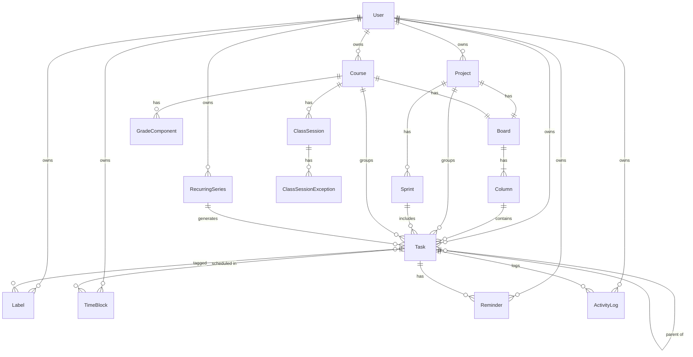

# 04. Mô hình dữ liệu

## 1. Sơ đồ quan hệ



## 2. Lược đồ Prisma

Đây là bản đặc tả. File thật `prisma/schema.prisma` phải khớp với nó; khác biệt nào cũng phải cập nhật ngược lại vào đây.

Quy ước chung:

- Khóa chính `id String @id @default(cuid(2))`.
- Mọi thời điểm là `DateTime` lưu **UTC** (`timestamptz` trong PostgreSQL).
- Mọi bảng nghiệp vụ có `userId` và chỉ mục trên `userId`.
- `createdAt`, `updatedAt` trên mọi bảng có thể sửa.

```prisma
generator client {
  provider = "prisma-client"
  output   = "../src/generated/prisma"
}

datasource db {
  provider   = "postgresql"
  extensions = [unaccent, pg_trgm]
}

// ───────────── Xác thực (Better Auth) ─────────────
// Sinh bằng `npx @better-auth/cli generate`; chỉ thêm quan hệ và trường hồ sơ.

model User {
  id            String   @id
  name          String
  email         String   @unique
  emailVerified Boolean  @default(false)
  image         String?
  timezone      String   @default("Asia/Ho_Chi_Minh")
  locale        String   @default("vi")
  weekStartsOn  Int      @default(1)            // 1 = thứ Hai
  createdAt     DateTime @default(now())
  updatedAt     DateTime @updatedAt

  sessions        Session[]
  accounts        Account[]
  projects        Project[]
  courses         Course[]
  tasks           Task[]
  labels          Label[]
  timeBlocks      TimeBlock[]
  recurringSeries RecurringSeries[]
  notifications   Notification[]
  reminders       Reminder[]
  activityLogs    ActivityLog[]
}

model Session {
  id        String   @id
  userId    String
  token     String   @unique
  expiresAt DateTime
  ipAddress String?
  userAgent String?
  createdAt DateTime @default(now())
  updatedAt DateTime @updatedAt
  user      User     @relation(fields: [userId], references: [id], onDelete: Cascade)
  @@index([userId])
}

model Account {
  id                    String    @id
  userId                String
  accountId             String
  providerId            String
  accessToken           String?
  refreshToken          String?
  accessTokenExpiresAt  DateTime?
  refreshTokenExpiresAt DateTime?
  scope                 String?
  idToken               String?
  password              String?
  createdAt             DateTime  @default(now())
  updatedAt             DateTime  @updatedAt
  user                  User      @relation(fields: [userId], references: [id], onDelete: Cascade)
  @@index([userId])
}

model Verification {
  id         String   @id
  identifier String
  value      String
  expiresAt  DateTime
  createdAt  DateTime @default(now())
  updatedAt  DateTime @updatedAt
}

// Bộ đếm rate limit của Better Auth (NFR-11, storage: "database").
// Trường chính xác lấy theo output của `npx @better-auth/cli generate`; khác thì cập nhật lại đây.
model RateLimit {
  id          String @id
  key         String @unique
  count       Int
  lastRequest BigInt
}

// ───────────── Enum ─────────────

enum StatusCategory { TODO IN_PROGRESS DONE }
enum Priority       { URGENT HIGH MEDIUM LOW }
enum Workflow       { KANBAN SCRUM }
enum EstimateUnit   { POINTS HOURS }
enum ProjectStatus  { ACTIVE ARCHIVED }
enum SprintStatus   { PLANNED ACTIVE COMPLETED }
enum ActivityType {
  TASK_CREATED
  STATUS_CHANGED
  ESTIMATE_CHANGED
  DUE_CHANGED
  ADDED_TO_SPRINT
  REMOVED_FROM_SPRINT
  DELETED
  RESTORED
}

// ───────────── Dự án và bảng ─────────────

model Project {
  id           String        @id @default(cuid(2))
  userId       String
  name         String        @db.VarChar(120)
  description  String?
  color        String        @default("#6366F1")   // mã hex
  workflow     Workflow      @default(KANBAN)
  estimateUnit EstimateUnit  @default(POINTS)
  status       ProjectStatus @default(ACTIVE)
  startDate    DateTime?     @db.Date
  endDate      DateTime?     @db.Date
  deletedAt    DateTime?
  createdAt    DateTime      @default(now())
  updatedAt    DateTime      @updatedAt

  user    User     @relation(fields: [userId], references: [id], onDelete: Cascade)
  board   Board?
  tasks   Task[]
  sprints Sprint[]

  @@index([userId, deletedAt])
}

model Board {
  id        String   @id @default(cuid(2))
  userId    String
  projectId String?  @unique
  courseId  String?  @unique
  createdAt DateTime @default(now())

  project Project? @relation(fields: [projectId], references: [id], onDelete: Cascade)
  course  Course?  @relation(fields: [courseId], references: [id], onDelete: Cascade)
  columns Column[]

  @@index([userId])
  // Ràng buộc CHECK (viết tay trong migration SQL):
  // CHECK (("projectId" IS NULL) <> ("courseId" IS NULL))   -- đúng một trong hai (ADR-04)
}

model Column {
  id             String         @id @default(cuid(2))
  userId         String
  boardId        String
  name           String         @db.VarChar(60)
  statusCategory StatusCategory
  order          String                                   // fractional index, COLLATE "C" (ADR-05, mục 3)
  wipLimit       Int?                                     // null = không giới hạn
  wipStrict      Boolean        @default(false)
  createdAt      DateTime       @default(now())
  updatedAt      DateTime       @updatedAt

  board Board  @relation(fields: [boardId], references: [id], onDelete: Cascade)
  tasks Task[]

  @@index([boardId, order])
}

// ───────────── Việc ─────────────

model Task {
  id             String         @id @default(cuid(2))
  userId         String
  title          String         @db.VarChar(300)
  description    String?                                  // Markdown
  statusCategory StatusCategory @default(TODO)            // ADR-03
  priority       Priority       @default(MEDIUM)
  startAt        DateTime?
  dueAt          DateTime?
  dueAllDay      Boolean        @default(true)
  estimate       Decimal?       @db.Decimal(6, 2)         // điểm hoặc giờ theo Project.estimateUnit
  isMilestone    Boolean        @default(false)
  completedAt    DateTime?
  deletedAt      DateTime?

  projectId String?
  courseId  String?
  columnId  String?
  sprintId  String?
  parentId  String?
  order     String                                        // thứ tự trong cột / hộp thư; COLLATE "C" (ADR-05)
  backlogOrder String?                                    // thứ tự trong backlog (Scrum); COLLATE "C" (ADR-05)

  seriesId       String?
  occurrenceDate DateTime? @db.Date

  createdAt DateTime @default(now())
  updatedAt DateTime @updatedAt

  user      User             @relation(fields: [userId], references: [id], onDelete: Cascade)
  project   Project?         @relation(fields: [projectId], references: [id])
  course    Course?          @relation(fields: [courseId], references: [id], onDelete: SetNull)
  column    Column?          @relation(fields: [columnId], references: [id], onDelete: SetNull)
  sprint    Sprint?          @relation(fields: [sprintId], references: [id], onDelete: SetNull)
  parent    Task?            @relation("Subtasks", fields: [parentId], references: [id])
  subtasks  Task[]           @relation("Subtasks")
  series    RecurringSeries? @relation(fields: [seriesId], references: [id], onDelete: SetNull)
  labels    TaskLabel[]
  timeBlocks TimeBlock[]
  reminders Reminder[]
  activity  ActivityLog[]

  @@unique([seriesId, occurrenceDate])                     // BR-73
  @@index([userId, deletedAt, dueAt])
  @@index([userId, statusCategory])
  @@index([projectId, deletedAt])
  @@index([courseId, deletedAt])
  @@index([columnId, order])
  @@index([sprintId])
  @@index([parentId])
}

model Label {
  id        String      @id @default(cuid(2))
  userId    String
  name      String      @db.VarChar(40)
  color     String      @default("#64748B")
  createdAt DateTime    @default(now())
  user      User        @relation(fields: [userId], references: [id], onDelete: Cascade)
  tasks     TaskLabel[]
  // Duy nhất không phân biệt hoa thường (BR-81): chỉ mục viết tay
  // CREATE UNIQUE INDEX label_user_name_ci ON "Label" ("userId", lower("name"));
}

model TaskLabel {
  taskId  String
  labelId String
  task    Task  @relation(fields: [taskId], references: [id], onDelete: Cascade)
  label   Label @relation(fields: [labelId], references: [id], onDelete: Cascade)
  @@id([taskId, labelId])
  @@index([labelId])
}

// ───────────── Scrum ─────────────

model Sprint {
  id               String       @id @default(cuid(2))
  userId           String
  projectId        String
  name             String       @db.VarChar(80)
  goal             String?
  startDate        DateTime     @db.Date
  endDate          DateTime     @db.Date                  // ngày cuối, tính cả ngày này
  status           SprintStatus @default(PLANNED)
  committedPoints  Decimal?     @db.Decimal(8, 2)          // BR-43
  velocity         Decimal?     @db.Decimal(8, 2)          // BR-46
  burndownSnapshot Json?                                   // BR-46
  startedAt        DateTime?
  completedAt      DateTime?
  createdAt        DateTime     @default(now())
  updatedAt        DateTime     @updatedAt

  project Project @relation(fields: [projectId], references: [id], onDelete: Cascade)
  tasks   Task[]

  @@index([projectId, status])
  // BR-40: tối đa một sprint ACTIVE mỗi dự án (chỉ mục từng phần, viết tay):
  // CREATE UNIQUE INDEX sprint_one_active ON "Sprint" ("projectId") WHERE "status" = 'ACTIVE';
}

// ───────────── Môn học ─────────────

model Course {
  id              String    @id @default(cuid(2))
  userId          String
  name            String    @db.VarChar(120)
  code            String?   @db.VarChar(30)
  instructor      String?
  instructorEmail String?
  semester        String?   @db.VarChar(40)
  credits         Int?
  color           String    @default("#0EA5E9")
  termStart       DateTime? @db.Date
  termEnd         DateTime? @db.Date
  targetScore     Decimal?  @db.Decimal(4, 2)             // thang 10
  notes           String?
  deletedAt       DateTime?
  createdAt       DateTime  @default(now())
  updatedAt       DateTime  @updatedAt

  user     User             @relation(fields: [userId], references: [id], onDelete: Cascade)
  board    Board?
  tasks    Task[]
  sessions ClassSession[]
  grades   GradeComponent[]

  @@index([userId, deletedAt])
}

model ClassSession {
  id        String  @id @default(cuid(2))
  courseId  String
  weekday   Int                       // 1 = thứ Hai … 7 = Chủ nhật (ISO 8601)
  startTime String  @db.VarChar(5)    // "HH:mm" giờ địa phương (BR-53)
  endTime   String  @db.VarChar(5)
  room      String? @db.VarChar(60)
  kind      String? @db.VarChar(30)   // "Lý thuyết", "Thực hành"...

  course     Course                  @relation(fields: [courseId], references: [id], onDelete: Cascade)
  exceptions ClassSessionException[]
}

model ClassSessionException {
  id           String       @id @default(cuid(2))
  sessionId    String
  date         DateTime     @db.Date
  cancelled    Boolean      @default(false)
  newStartTime String?      @db.VarChar(5)
  newEndTime   String?      @db.VarChar(5)
  newRoom      String?
  note         String?
  session      ClassSession @relation(fields: [sessionId], references: [id], onDelete: Cascade)
  @@unique([sessionId, date])
}

model GradeComponent {
  id       String   @id @default(cuid(2))
  courseId String
  name     String   @db.VarChar(60)       // "Chuyên cần", "Giữa kỳ"...
  weight   Decimal  @db.Decimal(5, 2)     // phần trăm, 0–100
  score    Decimal? @db.Decimal(6, 2)     // null = chưa có điểm
  maxScore Decimal  @db.Decimal(6, 2) @default(10)
  order    String                         // COLLATE "C" (ADR-05)
  course   Course   @relation(fields: [courseId], references: [id], onDelete: Cascade)
  @@index([courseId])
}

// ───────────── Lịch trình ─────────────

model TimeBlock {
  id        String   @id @default(cuid(2))
  userId    String
  taskId    String?
  title     String?  @db.VarChar(200)     // bắt buộc nếu không có taskId (BR-60)
  startAt   DateTime
  endAt     DateTime
  createdAt DateTime @default(now())
  updatedAt DateTime @updatedAt

  user User  @relation(fields: [userId], references: [id], onDelete: Cascade)
  task Task? @relation(fields: [taskId], references: [id], onDelete: Cascade)

  @@index([userId, startAt])
  // CHECK ("endAt" > "startAt"); CHECK ("taskId" IS NOT NULL OR "title" IS NOT NULL)
}

model RecurringSeries {
  id          String    @id @default(cuid(2))
  userId      String
  rule        String                       // tập con RRULE (BR-71)
  startDate   DateTime  @db.Date
  template    Json                         // { title, description, projectId, courseId, labelIds, estimate, priority, dueTime }
  skipDates   DateTime[] @db.Date          // ngoại lệ đã xóa (BR-74)
  active      Boolean   @default(true)
  createdAt   DateTime  @default(now())
  updatedAt   DateTime  @updatedAt

  user  User   @relation(fields: [userId], references: [id], onDelete: Cascade)
  tasks Task[]
  @@index([userId, active])
}

// ───────────── Nhắc hạn, thông báo, nhật ký ─────────────

model Reminder {
  id            String    @id @default(cuid(2))
  userId        String
  taskId        String
  offsetMinutes Int                          // số phút trước hạn
  fireAt        DateTime                     // tính sẵn = dueAt - offset (BR-92)
  sentAt        DateTime?
  user          User      @relation(fields: [userId], references: [id], onDelete: Cascade)
  task          Task      @relation(fields: [taskId], references: [id], onDelete: Cascade)
  @@index([fireAt, sentAt])
  @@index([userId])
}

model Notification {
  id        String    @id @default(cuid(2))
  userId    String
  kind      String                           // "REMINDER", "OVERDUE"...
  title     String
  body      String?
  taskId    String?
  readAt    DateTime?
  createdAt DateTime  @default(now())
  user      User      @relation(fields: [userId], references: [id], onDelete: Cascade)
  @@index([userId, readAt])
}

model ActivityLog {
  id        String       @id @default(cuid(2))
  userId    String
  taskId    String
  type      ActivityType
  fromValue Json?
  toValue   Json?
  sprintId  String?                           // để lọc nhanh khi dựng burndown
  at        DateTime     @default(now())
  user      User         @relation(fields: [userId], references: [id], onDelete: Cascade)
  task      Task         @relation(fields: [taskId], references: [id], onDelete: Cascade)
  @@index([sprintId, at])
  @@index([taskId, at])
  @@index([userId, at])
}
```

## 3. Ràng buộc viết tay trong migration

Prisma không biểu diễn được các ràng buộc sau; thêm bằng SQL trong file migration (`npx prisma migrate dev --create-only`, sửa SQL, rồi áp dụng).

Tên bảng và tên cột giữ **camelCase đúng như model Prisma** (không dùng `@map`), nên trong SQL luôn đặt trong ngoặc kép: `"Task"`, `"projectId"`, `"endAt"`. Viết không có ngoặc kép thì PostgreSQL đổi sang chữ thường và báo lỗi không tìm thấy cột.

| Ràng buộc (SQL) | Mục đích |
|---|---|
| `ALTER TABLE "Board" ADD CONSTRAINT board_owner_xor CHECK (("projectId" IS NULL) <> ("courseId" IS NULL));` | ADR-04 |
| `CREATE UNIQUE INDEX sprint_one_active ON "Sprint" ("projectId") WHERE "status" = 'ACTIVE';` | BR-40 |
| `CREATE UNIQUE INDEX label_user_name_ci ON "Label" ("userId", lower("name"));` | BR-81 |
| `ALTER TABLE "TimeBlock" ADD CONSTRAINT timeblock_range CHECK ("endAt" > "startAt");` | BR-61 |
| `ALTER TABLE "TimeBlock" ADD CONSTRAINT timeblock_task_or_title CHECK ("taskId" IS NOT NULL OR "title" IS NOT NULL);` | BR-60 |
| `ALTER TABLE "GradeComponent" ADD CONSTRAINT grade_weight_range CHECK ("weight" >= 0 AND "weight" <= 100);` | BR-54 |
| `ALTER TABLE "Task" ADD CONSTRAINT task_estimate_nonneg CHECK ("estimate" IS NULL OR "estimate" >= 0);` | BR-41 |
| `CREATE INDEX task_title_trgm ON "Task" USING gin (unaccent(lower("title")) gin_trgm_ops);` | BR-82, tìm kiếm nhanh |
| `ALTER TABLE "Task" ALTER COLUMN "order" TYPE text COLLATE "C";` | ADR-05 |
| `ALTER TABLE "Task" ALTER COLUMN "backlogOrder" TYPE text COLLATE "C";` | ADR-05 |
| `ALTER TABLE "Column" ALTER COLUMN "order" TYPE text COLLATE "C";` | ADR-05 |
| `ALTER TABLE "GradeComponent" ALTER COLUMN "order" TYPE text COLLATE "C";` | ADR-05 |

Ghi chú:

- `unaccent()` mặc định không phải hàm `IMMUTABLE` nên PostgreSQL không cho dùng trực tiếp trong chỉ mục. Khi viết migration, bọc nó trong một hàm `IMMUTABLE` riêng (ví dụ `f_unaccent`) rồi dùng hàm đó cho cả chỉ mục lẫn truy vấn tìm kiếm.
- Các cột `order` đặt collation `"C"` để so sánh theo byte, khớp với cách `fractional-indexing` sinh khóa (ADR-05). Sau đó Prisma `orderBy: { order: "asc" }` dùng bình thường, không cần SQL thô. Mỗi lần migration sau đụng tới các cột này, kiểm tra lại collation vẫn là `"C"` (TC-25).

Các ràng buộc không làm được ở DB (kiểm tra ở tầng dịch vụ): BR-05 (2 cấp), BR-06 (việc con cùng dự án), BR-25 (bảng luôn có cột TODO và DONE), BR-41 (có ước lượng mới vào sprint).

## 4. Bất biến (invariant) tầng dịch vụ phải giữ

1. `task.columnId != null` ⇒ `task.statusCategory == column.statusCategory` (BR-01, ADR-03).
2. `task.columnId != null` ⇒ cột thuộc bảng của `task.projectId`, hoặc nếu không có dự án thì bảng của `task.courseId` (BR-24).
3. `task.sprintId != null` ⇒ `sprint.projectId == task.projectId` và `task.parentId == null` (BR-42).
4. `task.statusCategory == DONE` ⇔ `task.completedAt != null` (BR-03).
5. Mọi bản ghi được đọc/ghi đều có `userId` bằng người đang đăng nhập (US-03). Bảng con không có `userId` (`ClassSession`, `GradeComponent`...) được kiểm tra qua bảng cha.

Test TC-12 và TC-13 kiểm tra các bất biến này sau mỗi thao tác dịch vụ.

## 5. Dữ liệu mẫu (`prisma/seed.ts`)

Chỉ dùng khi dev. Tạo một người dùng `demo@taskflow.local` với:

- 2 dự án: "Website cá nhân" (Kanban, 12 việc), "Ứng dụng đặt lịch" (Scrum, 2 sprint đã xong, 1 đang chạy).
- 4 môn học, mỗi môn 2 buổi học/tuần, 3–5 bài tập, 3 điểm thành phần.
- 5 việc lẻ trong Hộp thư, 2 trong số đó trễ hạn.
